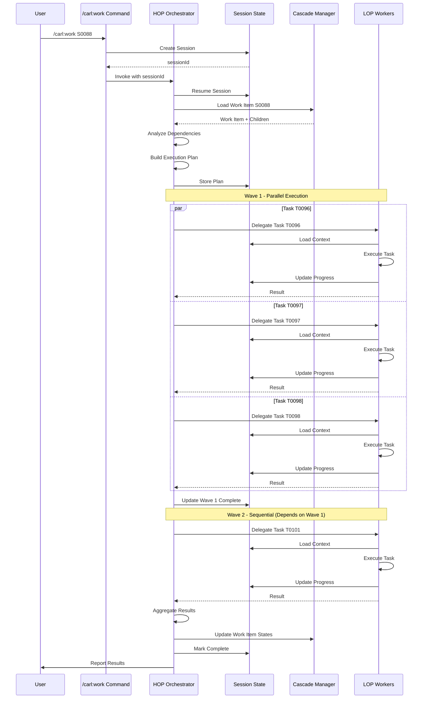
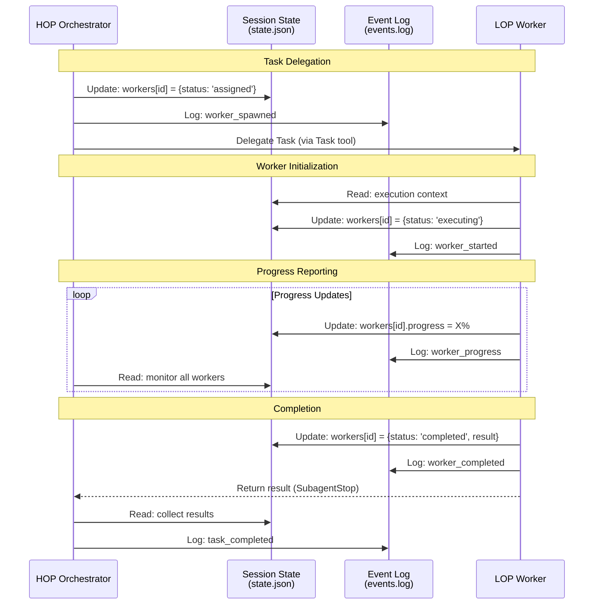
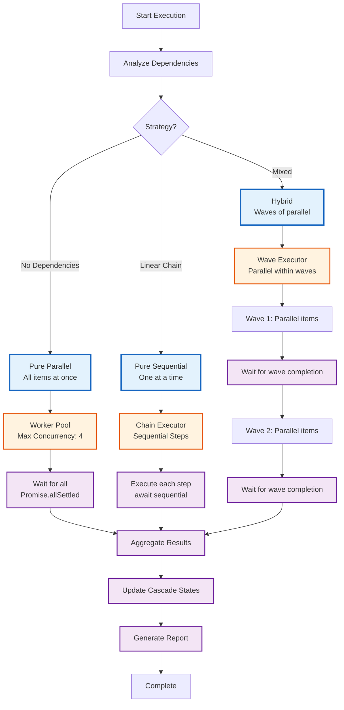
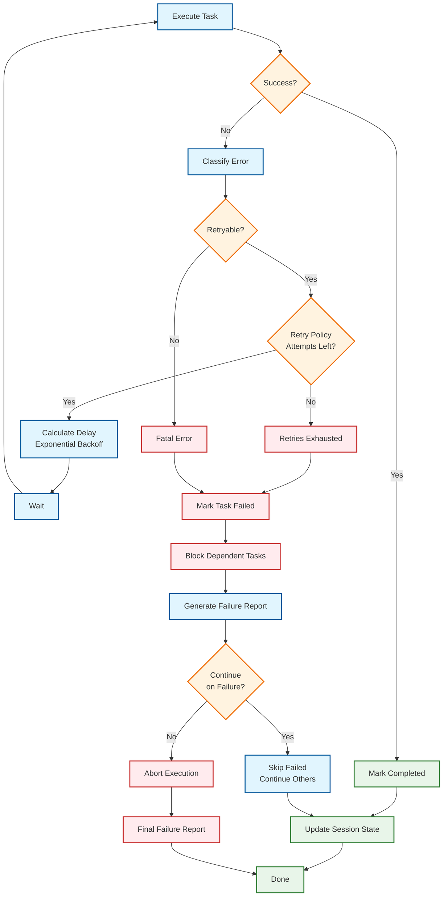

# Worker Agent Architecture (HOP/LOP Pattern)

**Epic**: E0002 - Work Orchestrator Autonomous Execution Agent
**Feature**: F0006 - HOP/LOP Worker Agent Pattern
**Story**: S0088 - Define Worker Agent Architecture
**Status**: Designed
**Version**: 1.0.0

## Table of Contents

1. [Overview](#overview)
2. [Worker Agent Types and Specializations](#worker-agent-types-and-specializations)
3. [HOP Orchestrator Interface](#hop-orchestrator-interface)
4. [LOP Worker Interface](#lop-worker-interface)
5. [Agent Communication Protocol](#agent-communication-protocol)
6. [Session-Based Coordination Mechanism](#session-based-coordination-mechanism)
7. [Architecture Diagram](#architecture-diagram)
8. [Implementation Guidelines](#implementation-guidelines)
9. [References](#references)

---

## Overview

The Worker Agent Architecture implements IndyDevDan's **HOP/LOP (Higher Order Prompt / Lower Order Prompt)** pattern for multi-agent coordination in CARL. This architecture enables the Work Orchestrator to delegate execution to specialized worker agents that operate independently with clean context separation.

### Core Principles

Following IndyDevDan's agentic orchestration patterns:

1. **Async-First Execution** - "Do more when possible, wait when needed"
2. **Clean Context Separation** - Each agent operates in its own context window
3. **Event-Driven Coordination** - Agents coordinate through session state and events
4. **Observable by Default** - Real-time progress tracking and monitoring
5. **Graceful Degradation** - Independent failure handling with partial completion
6. **Agent Specialization** - "Use the right tool (agent) for the job"

### Architecture Pattern

```
HOP (Higher Order Prompt) - Orchestrator
  |
  |- Analyzes work breakdown
  |- Creates execution plan
  |- Delegates to specialized workers
  |- Monitors progress via events
  |- Aggregates results
  |- Handles coordination
  |
  +---> LOP (Lower Order Prompt) - Specialized Workers
         |
         |- Code Generation Worker
         |- Testing Worker
         |- Documentation Worker
         |- Code Review Worker
         |- Analysis Worker
         |- Integration Worker
         |- Deployment Worker
```

---

## Worker Agent Types and Specializations

Worker agents are specialized LOP instances designed for specific domain tasks. Each type has well-defined capabilities, responsibilities, and limitations.

### 1. Code Generation Worker

**Specialization**: Creating new code, components, and modules

**Capabilities**:
- Generate code from specifications and requirements
- Create new files, classes, functions, and modules
- Implement features based on detailed specifications
- Follow existing code patterns and conventions
- Generate boilerplate and scaffolding

**Limitations**:
- Does not analyze existing complex codebases (use Analysis Worker)
- Does not perform testing (use Testing Worker)
- Does not review code quality (use Code Review Worker)

**When to Use**:
- Creating new features from scratch
- Generating boilerplate code
- Implementing well-specified requirements
- Creating test fixtures or mocks

**Tool Access**:
- Write, Edit (primary)
- Read (for patterns/templates)
- Bash (for scaffolding commands)
- Glob (for finding templates)

**Example Task**:
```json
{
  "type": "code-generation",
  "workItemId": "T0123",
  "description": "Implement user authentication service",
  "specification": "...",
  "context": {
    "language": "JavaScript",
    "framework": "Express.js",
    "patterns": ["Service pattern", "Repository pattern"]
  }
}
```

---

### 2. Testing Worker

**Specialization**: Creating and executing tests

**Capabilities**:
- Write unit tests, integration tests, E2E tests
- Execute test suites and report results
- Generate test fixtures and mocks
- Analyze test coverage
- Debug failing tests

**Limitations**:
- Does not implement production code (use Code Generation Worker)
- Does not review architecture (use Code Review Worker)
- Does not deploy tests (use Deployment Worker)

**When to Use**:
- Creating test suites for new features
- Debugging failing tests
- Expanding test coverage
- Generating test data/fixtures

**Tool Access**:
- Write, Edit (for test files)
- Bash (for running tests)
- Read (for code under test)
- Grep (for finding test patterns)

**Example Task**:
```json
{
  "type": "testing",
  "workItemId": "T0124",
  "description": "Create unit tests for authentication service",
  "targetCode": "src/services/auth-service.js",
  "testFramework": "Jest",
  "coverageTarget": 90
}
```

---

### 3. Documentation Worker

**Specialization**: Creating and updating documentation

**Capabilities**:
- Write technical documentation (API docs, guides, READMEs)
- Generate JSDoc/TSDoc comments
- Create architecture diagrams (Mermaid)
- Document design decisions and patterns
- Update changelog and release notes

**Limitations**:
- Does not implement features (use Code Generation Worker)
- Does not analyze architecture (use Analysis Worker)
- Does not test code (use Testing Worker)

**When to Use**:
- Documenting new features
- Creating API documentation
- Writing user guides
- Generating architecture diagrams
- Updating project documentation

**Tool Access**:
- Write, Edit (primary)
- Read (for understanding code to document)
- Glob (for finding doc templates)

**Example Task**:
```json
{
  "type": "documentation",
  "workItemId": "T0125",
  "description": "Document authentication API endpoints",
  "scope": "API reference and usage examples",
  "format": "Markdown with JSDoc",
  "audience": "developers"
}
```

---

### 4. Code Review Worker

**Specialization**: Analyzing code quality and providing feedback

**Capabilities**:
- Review code for best practices and patterns
- Identify bugs, security issues, performance problems
- Check code style and conventions
- Suggest improvements and refactorings
- Validate architectural decisions

**Limitations**:
- Does not implement fixes (use Code Generation Worker)
- Does not write tests (use Testing Worker)
- Does not execute code (use Testing Worker)

**When to Use**:
- Reviewing pull requests
- Pre-commit code quality checks
- Architecture validation
- Security audits
- Performance analysis

**Tool Access**:
- Read (primary)
- Grep (for pattern analysis)
- Glob (for finding related files)
- Bash (for running linters/analyzers)

**Example Task**:
```json
{
  "type": "code-review",
  "workItemId": "T0126",
  "description": "Review authentication service implementation",
  "criteria": ["security", "performance", "maintainability"],
  "standards": "CARL coding standards"
}
```

---

### 5. Analysis Worker

**Specialization**: Deep code analysis and understanding

**Capabilities**:
- Analyze complex codebases
- Map dependencies and relationships
- Identify patterns and anti-patterns
- Understand system architecture
- Generate impact analysis
- Create refactoring recommendations

**Limitations**:
- Does not implement changes (use Code Generation Worker)
- Does not test code (use Testing Worker)
- Does not review style (use Code Review Worker)

**When to Use**:
- Understanding unfamiliar codebases
- Planning large refactorings
- Dependency analysis
- Architecture assessment
- Impact analysis for changes

**Tool Access**:
- Read (primary)
- Grep (extensive use)
- Glob (for discovery)
- Bash (for analysis tools)

**Example Task**:
```json
{
  "type": "analysis",
  "workItemId": "T0127",
  "description": "Analyze authentication service dependencies",
  "scope": "All files using auth service",
  "output": "Dependency graph and impact report"
}
```

---

### 6. Integration Worker

**Specialization**: Connecting components and systems

**Capabilities**:
- Integrate multiple components
- Configure service connections
- Set up API integrations
- Handle data transformations
- Manage configuration

**Limitations**:
- Does not create core business logic (use Code Generation Worker)
- Does not test integrations (use Testing Worker)
- Does not deploy (use Deployment Worker)

**When to Use**:
- Connecting services and APIs
- Setting up third-party integrations
- Configuring middleware
- Data pipeline setup

**Tool Access**:
- Write, Edit (configuration)
- Read (for existing integrations)
- Bash (for testing connections)
- Grep (for finding integration points)

**Example Task**:
```json
{
  "type": "integration",
  "workItemId": "T0128",
  "description": "Integrate OAuth provider with auth service",
  "provider": "GitHub OAuth",
  "configuration": "..."
}
```

---

### 7. Deployment Worker

**Specialization**: Deploying and releasing code

**Capabilities**:
- Build and package applications
- Deploy to environments
- Configure CI/CD pipelines
- Manage releases
- Handle rollbacks

**Limitations**:
- Does not implement features (use Code Generation Worker)
- Does not write tests (use Testing Worker)
- Does not review code (use Code Review Worker)

**When to Use**:
- Deploying applications
- Setting up CI/CD
- Creating release packages
- Managing deployments

**Tool Access**:
- Bash (primary - deployment scripts)
- Read (for configs)
- Write (for deployment configs)

**Example Task**:
```json
{
  "type": "deployment",
  "workItemId": "T0129",
  "description": "Deploy authentication service to staging",
  "environment": "staging",
  "strategy": "blue-green"
}
```

---

### 8. Refactoring Worker

**Specialization**: Code improvement and restructuring

**Capabilities**:
- Refactor code for better structure
- Extract common patterns
- Rename and reorganize
- Improve performance
- Reduce technical debt

**Limitations**:
- Does not create new features (use Code Generation Worker)
- Does not write tests initially (use Testing Worker)
- Requires existing tests for safety

**When to Use**:
- Improving code structure
- Extracting reusable components
- Performance optimization
- Technical debt reduction

**Tool Access**:
- Edit (primary)
- Read (extensive)
- Grep (for finding usages)
- Bash (for running tests)

**Example Task**:
```json
{
  "type": "refactoring",
  "workItemId": "T0130",
  "description": "Extract common authentication logic into utilities",
  "scope": "src/services/",
  "safetyCheck": "Run test suite after each step"
}
```

---

### Worker Selection Guide

**Decision Tree**:

```
Need to create new code?
  └─> Code Generation Worker

Need to test code?
  └─> Testing Worker

Need to understand existing code?
  └─> Analysis Worker

Need to review code quality?
  └─> Code Review Worker

Need to write documentation?
  └─> Documentation Worker

Need to connect systems?
  └─> Integration Worker

Need to deploy/release?
  └─> Deployment Worker

Need to improve existing code structure?
  └─> Refactoring Worker
```

---

## HOP Orchestrator Interface

The HOP (Higher Order Prompt) Orchestrator is the top-level coordinator responsible for analyzing work, creating execution plans, delegating to workers, and aggregating results.

### Responsibilities

1. **Work Analysis**
   - Load work items from Cascade
   - Parse hierarchy and dependencies
   - Validate work item state and readiness

2. **Execution Planning**
   - Build dependency graphs
   - Identify parallelizable work
   - Create execution waves
   - Select appropriate worker agents

3. **Worker Lifecycle Management**
   - Spawn specialized worker agents
   - Provide necessary context
   - Monitor worker execution
   - Collect worker results
   - Handle worker failures

4. **Session Management**
   - Create and initialize sessions
   - Track execution state
   - Coordinate shared context
   - Persist progress

5. **Event Coordination**
   - Listen to worker events
   - Update progress tracking
   - Emit coordination events
   - Log execution timeline

6. **Error Handling and Recovery**
   - Detect worker failures
   - Apply retry policies
   - Block dependent items
   - Generate failure reports
   - Implement graceful degradation

7. **Result Aggregation**
   - Collect worker outputs
   - Synthesize final results
   - Update work item states
   - Generate completion reports

---

### Interface Definition

```javascript
/**
 * HOP Orchestrator Interface
 *
 * The orchestrator coordinates work execution across specialized worker agents.
 */
class HOPOrchestrator {

  /**
   * Initialize orchestrator with work item
   * @param {string} workItemId - Work item to execute (E####, F####, S####, T####)
   * @param {Object} options - Execution options
   * @returns {Promise<void>}
   */
  async initialize(workItemId, options = {}) {}

  /**
   * Load work item and complete hierarchy from Cascade
   * @returns {Promise<Object>} Work item with children
   */
  async loadWorkItem() {}

  /**
   * Analyze dependencies and create execution plan
   * @returns {Promise<ExecutionPlan>} Execution plan with waves
   */
  async analyze() {}

  /**
   * Delegate task to appropriate worker agent
   * @param {Object} task - Task definition
   * @param {string} task.id - Task identifier
   * @param {string} task.type - Worker type to use
   * @param {Object} task.context - Task context
   * @returns {Promise<string>} Worker agent ID
   */
  async delegate(task) {}

  /**
   * Monitor worker agent execution
   * @param {string} workerId - Worker agent ID
   * @returns {Promise<WorkerStatus>} Current worker status
   */
  async monitor(workerId) {}

  /**
   * Collect results from completed worker
   * @param {string} workerId - Worker agent ID
   * @returns {Promise<Object>} Worker results
   */
  async collectResults(workerId) {}

  /**
   * Execute complete work item
   * Coordinates all workers according to execution plan
   * @returns {Promise<ExecutionResult>} Final execution result
   */
  async execute() {}

  /**
   * Handle worker failure
   * @param {string} workerId - Failed worker ID
   * @param {Error} error - Failure error
   * @returns {Promise<RecoveryAction>} Recovery action taken
   */
  async handleFailure(workerId, error) {}

  /**
   * Generate execution report
   * @returns {Promise<Object>} Execution report
   */
  async generateReport() {}

  /**
   * Update Cascade work item states
   * @returns {Promise<void>}
   */
  async updateWorkItems() {}
}
```

---

### Execution Plan Structure

```javascript
/**
 * Execution Plan created by HOP Orchestrator
 */
{
  "executionId": "uuid",
  "workItemId": "S0088",
  "strategy": "hybrid",  // parallel | sequential | hybrid
  "waves": [
    {
      "waveIndex": 0,
      "items": [
        {
          "itemId": "T0096",
          "workerType": "documentation",
          "dependencies": [],
          "priority": "high"
        },
        {
          "itemId": "T0097",
          "workerType": "documentation",
          "dependencies": [],
          "priority": "high"
        }
      ]
    },
    {
      "waveIndex": 1,
      "items": [
        {
          "itemId": "T0101",
          "workerType": "documentation",
          "dependencies": ["T0096", "T0097", "T0098", "T0099", "T0100"],
          "priority": "medium"
        }
      ]
    }
  ],
  "metrics": {
    "totalWaves": 2,
    "totalItems": 6,
    "maxConcurrency": 4,
    "criticalPathLength": 2,
    "parallelismFactor": 3.0
  }
}
```

---

### Session Management

The HOP Orchestrator uses SessionState for coordination:

```javascript
// Example: HOP creates and manages session
const session = new SessionState();
await session.initialize();

await session.setWorkflow({
  name: 'work-execution',
  agent: 'work-orchestrator',
  status: 'executing',
  workItemId: 'S0088'
});

await session.setState({
  executionPlan: plan,
  currentWave: 0,
  workers: {}
});

// Workers resume this session
const workerId = await this.delegate({
  sessionId: session.sessionId,
  task: taskDef
});

await session.setState({
  workers: {
    [workerId]: { status: 'running', taskId: 'T0096' }
  }
});
```

---

### Event Emissions

The HOP Orchestrator emits events for observability:

```javascript
// Execution lifecycle
this.emit('execution:started', { executionId, workItemId });
this.emit('execution:completed', { results });
this.emit('execution:failed', { error, failureReport });

// Wave coordination
this.emit('wave:started', { waveIndex, items });
this.emit('wave:completed', { waveIndex, results });

// Worker coordination
this.emit('worker:spawned', { workerId, workerType, taskId });
this.emit('worker:completed', { workerId, result });
this.emit('worker:failed', { workerId, error });

// Progress tracking
this.emit('progress:update', { completed, total, percentage });
this.emit('item:completed', { itemId, result });
this.emit('item:blocked', { itemId, reason, blockedBy });
```

---

### Error Handling Strategy

```javascript
/**
 * HOP Error Handling Flow
 */
async handleFailure(workerId, error) {
  // 1. Classify error
  const errorType = this.classifyError(error);

  // 2. Check retry policy
  const retryPolicy = this.getRetryPolicy(workerId);

  if (retryPolicy.shouldRetry(error)) {
    // 3. Retry worker
    await this.retryWorker(workerId, retryPolicy);
    return { action: 'retry', workerId };
  }

  // 4. Mark task as failed
  await this.markTaskFailed(workerId, error);

  // 5. Block dependent tasks
  const blockedTasks = await this.blockDependentTasks(workerId);

  // 6. Generate failure report
  const report = await this.generateFailureReport(workerId, error);

  // 7. Emit failure events
  this.emit('worker:failed', { workerId, error, blockedTasks, report });

  // 8. Decide: continue or abort
  if (this.config.continueOnFailure) {
    return { action: 'continue', blockedTasks };
  } else {
    return { action: 'abort', error };
  }
}
```

---

## LOP Worker Interface

The LOP (Lower Order Prompt) Worker is a specialized agent that executes a specific task delegated by the HOP Orchestrator.

### Responsibilities

1. **Task Execution**
   - Receive task from orchestrator
   - Understand requirements and context
   - Execute specialized work
   - Produce results

2. **Context Management**
   - Resume session state
   - Load work item context
   - Access shared execution context
   - Maintain clean, focused context

3. **Result Reporting**
   - Format results appropriately
   - Report completion status
   - Provide detailed output
   - Update session state

4. **Error Reporting**
   - Detect and classify errors
   - Report failures clearly
   - Provide debugging context
   - Escalate when needed

5. **Progress Communication**
   - Report progress updates
   - Emit lifecycle events
   - Update session state
   - Enable monitoring

6. **Clarification Requests**
   - Identify ambiguities
   - Request additional information
   - Wait for orchestrator response
   - Continue when clarified

---

### Interface Definition

```javascript
/**
 * LOP Worker Interface
 *
 * Specialized agent that executes delegated tasks
 */
class LOPWorker {

  /**
   * Initialize worker with session and task
   * @param {string} sessionId - Shared session ID
   * @param {Object} task - Task definition
   * @returns {Promise<void>}
   */
  async initialize(sessionId, task) {}

  /**
   * Load context from session state
   * @returns {Promise<Object>} Execution context
   */
  async loadContext() {}

  /**
   * Execute assigned task
   * Implements worker-specific logic
   * @returns {Promise<Object>} Task result
   */
  async execute() {}

  /**
   * Report progress update
   * @param {Object} progress - Progress information
   * @returns {Promise<void>}
   */
  async reportProgress(progress) {}

  /**
   * Report successful completion
   * @param {Object} result - Execution result
   * @returns {Promise<void>}
   */
  async reportSuccess(result) {}

  /**
   * Report failure
   * @param {Error} error - Failure error
   * @param {Object} context - Error context
   * @returns {Promise<void>}
   */
  async reportFailure(error, context) {}

  /**
   * Request clarification from orchestrator
   * @param {string} question - Question to ask
   * @param {Array} options - Possible answers
   * @returns {Promise<Object>} Orchestrator response
   */
  async requestClarification(question, options) {}
}
```

---

### Task Definition Structure

Tasks are defined by the HOP and passed to LOP workers:

```javascript
/**
 * Task definition for LOP Worker
 */
{
  "taskId": "T0096",
  "workItemId": "T0096",
  "sessionId": "session-uuid",
  "workerType": "documentation",
  "priority": "high",
  "description": "Document worker agent types and specializations",
  "acceptanceCriteria": [
    "List all worker agent types with descriptions",
    "Define specialization areas for each type",
    "Document capabilities and limitations",
    "Specify when to use each agent type"
  ],
  "context": {
    "workItem": { /* full work item */ },
    "relatedItems": [],
    "references": [
      "docs/indydevdan/agentic-orchestration-patterns.md"
    ]
  },
  "constraints": {
    "maxDuration": 300000,  // 5 minutes
    "requiredTools": ["Write", "Read"],
    "outputFormat": "markdown"
  }
}
```

---

### Result Format

Workers return standardized results:

```javascript
/**
 * LOP Worker Result Format
 */
{
  "success": true,
  "taskId": "T0096",
  "workerId": "worker-uuid",
  "workerType": "documentation",
  "duration": 45000,  // ms
  "result": {
    // Worker-specific result data
    "filesCreated": ["worker-agent-architecture.md"],
    "filesModified": [],
    "output": "Documentation created successfully"
  },
  "metadata": {
    "toolsUsed": ["Write", "Read"],
    "iterations": 1,
    "tokensUsed": 15000
  },
  "timestamp": "2025-11-14T10:30:00Z"
}
```

---

### Error Reporting Format

Workers report errors with context:

```javascript
/**
 * LOP Worker Error Format
 */
{
  "success": false,
  "taskId": "T0096",
  "workerId": "worker-uuid",
  "error": {
    "type": "ExecutionError",
    "message": "Failed to create documentation file",
    "code": "FILE_WRITE_ERROR",
    "severity": "critical",  // critical | high | medium | low
    "retryable": true,
    "cause": {
      "error": "EACCES",
      "path": "/protected/file.md"
    }
  },
  "context": {
    "step": "writing-file",
    "attemptedAction": "Write to file",
    "partialResult": null
  },
  "debugInfo": {
    "stackTrace": "...",
    "environment": {},
    "state": {}
  },
  "timestamp": "2025-11-14T10:30:00Z"
}
```

---

### Worker State Transitions

```
[Initialized] -> [Loading Context] -> [Executing] -> [Reporting] -> [Completed]
                                          |
                                          v
                                    [Failed] -> [Retry?]
                                          |
                                          v
                                    [Reported Error]
```

---

### Session Interaction Pattern

```javascript
// Worker resumes session created by HOP
const session = await SessionState.resume(sessionId);

// Load execution context
const context = await session.getState();
const task = context.tasks[taskId];

// Update worker status
await session.setState({
  workers: {
    [workerId]: {
      status: 'executing',
      startTime: Date.now()
    }
  }
});

// Log progress event
await session.logEvent('worker:progress', {
  workerId,
  taskId,
  progress: 50
});

// Execute task
const result = await this.executeTask(task, context);

// Report result
await session.setState({
  workers: {
    [workerId]: {
      status: 'completed',
      result
    }
  }
});

await session.logEvent('worker:completed', {
  workerId,
  taskId,
  result
});
```

---

## Agent Communication Protocol

The communication protocol defines how HOP orchestrators and LOP workers exchange messages and coordinate execution.

### Protocol Overview

- **Transport**: Session state files + Event logs (file-based async messaging)
- **Format**: JSON
- **Pattern**: Request/Response with async event streaming
- **Correlation**: Session IDs + Work Item IDs + Worker IDs

---

### Message Envelope

All messages use a standard envelope format:

```javascript
{
  "envelope": {
    "version": "1.0",
    "messageId": "msg-uuid",
    "correlationId": "session-uuid",
    "timestamp": "2025-11-14T10:30:00Z",
    "sender": {
      "type": "HOP" | "LOP",
      "id": "orchestrator-id" | "worker-uuid",
      "agent": "work-orchestrator" | "code-generation-worker"
    },
    "recipient": {
      "type": "HOP" | "LOP",
      "id": "target-id"
    },
    "messageType": "request" | "response" | "event" | "error"
  },
  "payload": {
    // Message-specific data
  }
}
```

---

### Request Types

#### 1. Execute Task Request (HOP → LOP)

```javascript
{
  "envelope": {
    "messageType": "request",
    "sender": { "type": "HOP", "id": "orchestrator-1" }
  },
  "payload": {
    "type": "execute_task",
    "task": {
      "taskId": "T0096",
      "workerType": "documentation",
      "sessionId": "session-uuid",
      "description": "...",
      "acceptanceCriteria": [],
      "context": {}
    }
  }
}
```

#### 2. Query Status Request (HOP → LOP)

```javascript
{
  "envelope": {
    "messageType": "request",
    "sender": { "type": "HOP" }
  },
  "payload": {
    "type": "query_status",
    "workerId": "worker-uuid"
  }
}
```

#### 3. Cancel Task Request (HOP → LOP)

```javascript
{
  "envelope": {
    "messageType": "request",
    "sender": { "type": "HOP" }
  },
  "payload": {
    "type": "cancel_task",
    "workerId": "worker-uuid",
    "reason": "Dependency failed"
  }
}
```

#### 4. Request Clarification Request (LOP → HOP)

```javascript
{
  "envelope": {
    "messageType": "request",
    "sender": { "type": "LOP", "id": "worker-uuid" }
  },
  "payload": {
    "type": "request_clarification",
    "taskId": "T0096",
    "question": "Which documentation format should I use?",
    "options": [
      { "label": "Markdown", "value": "markdown" },
      { "label": "JSDoc", "value": "jsdoc" }
    ],
    "context": {}
  }
}
```

---

### Response Types

#### 1. Success Response

```javascript
{
  "envelope": {
    "messageType": "response",
    "sender": { "type": "LOP", "id": "worker-uuid" }
  },
  "payload": {
    "type": "success",
    "requestId": "msg-uuid",
    "result": {
      "success": true,
      "taskId": "T0096",
      "output": {},
      "metadata": {}
    }
  }
}
```

#### 2. Failure Response

```javascript
{
  "envelope": {
    "messageType": "response",
    "sender": { "type": "LOP", "id": "worker-uuid" }
  },
  "payload": {
    "type": "failure",
    "requestId": "msg-uuid",
    "error": {
      "type": "ExecutionError",
      "message": "...",
      "code": "ERROR_CODE",
      "retryable": true
    }
  }
}
```

#### 3. Progress Response

```javascript
{
  "envelope": {
    "messageType": "response",
    "sender": { "type": "LOP", "id": "worker-uuid" }
  },
  "payload": {
    "type": "progress",
    "taskId": "T0096",
    "progress": {
      "percentage": 50,
      "currentStep": "writing-documentation",
      "message": "Creating worker type documentation..."
    }
  }
}
```

#### 4. Clarification Response (HOP → LOP)

```javascript
{
  "envelope": {
    "messageType": "response",
    "sender": { "type": "HOP" }
  },
  "payload": {
    "type": "clarification_response",
    "requestId": "msg-uuid",
    "answer": {
      "selected": "markdown",
      "additional": "Use Markdown with Mermaid for diagrams"
    }
  }
}
```

---

### Event Types

#### 1. Worker Lifecycle Events

```javascript
// Worker started
{
  "envelope": { "messageType": "event" },
  "payload": {
    "type": "worker_started",
    "workerId": "worker-uuid",
    "taskId": "T0096",
    "timestamp": "..."
  }
}

// Worker completed
{
  "envelope": { "messageType": "event" },
  "payload": {
    "type": "worker_completed",
    "workerId": "worker-uuid",
    "taskId": "T0096",
    "result": {},
    "timestamp": "..."
  }
}

// Worker failed
{
  "envelope": { "messageType": "event" },
  "payload": {
    "type": "worker_failed",
    "workerId": "worker-uuid",
    "taskId": "T0096",
    "error": {},
    "timestamp": "..."
  }
}
```

#### 2. Progress Events

```javascript
{
  "envelope": { "messageType": "event" },
  "payload": {
    "type": "progress_update",
    "workerId": "worker-uuid",
    "taskId": "T0096",
    "progress": {
      "percentage": 75,
      "currentStep": "finalizing",
      "itemsCompleted": 3,
      "itemsTotal": 4
    }
  }
}
```

---

### Error Codes

Standard error codes for consistent error handling:

```javascript
const ErrorCodes = {
  // Execution Errors (4xxx)
  EXECUTION_ERROR: 4000,
  TIMEOUT: 4001,
  RESOURCE_UNAVAILABLE: 4002,
  INVALID_INPUT: 4003,
  PRECONDITION_FAILED: 4004,

  // Tool Errors (5xxx)
  TOOL_EXECUTION_FAILED: 5000,
  FILE_NOT_FOUND: 5001,
  FILE_WRITE_ERROR: 5002,
  PERMISSION_DENIED: 5003,

  // Worker Errors (6xxx)
  WORKER_INITIALIZATION_FAILED: 6000,
  WORKER_CRASHED: 6001,
  CONTEXT_LOAD_FAILED: 6002,

  // Coordination Errors (7xxx)
  SESSION_NOT_FOUND: 7000,
  STATE_CORRUPTION: 7001,
  COORDINATION_TIMEOUT: 7002
};
```

---

### Status Codes

```javascript
const StatusCodes = {
  // Success
  SUCCESS: 200,
  PARTIAL_SUCCESS: 206,

  // In Progress
  ACCEPTED: 202,
  PROCESSING: 204,

  // Client Errors
  BAD_REQUEST: 400,
  NOT_FOUND: 404,
  CONFLICT: 409,

  // Server Errors
  INTERNAL_ERROR: 500,
  NOT_IMPLEMENTED: 501,
  SERVICE_UNAVAILABLE: 503
};
```

---

### Communication Flow Patterns

#### Pattern 1: Async Fire-and-Forget (Parallel Execution)

```
HOP                          LOP Workers
 |                              |
 |-- execute_task(T1) --------> W1
 |-- execute_task(T2) --------> W2
 |-- execute_task(T3) --------> W3
 |                              |
 |<------ worker_completed ---- W1
 |<------ worker_completed ---- W2
 |<------ worker_completed ---- W3
 |                              |
 +-- aggregate results
```

#### Pattern 2: Sync Request-Response (Status Query)

```
HOP                          LOP Worker
 |                              |
 |-- query_status ------------> W1
 |<--- status_response -------- W1
 |                              |
```

#### Pattern 3: Bidirectional Clarification

```
HOP                          LOP Worker
 |                              |
 |-- execute_task ------------> W1
 |                              |
 |<-- request_clarification --- W1
 |                              |
 |-- clarification_response --> W1
 |                              |
 |<------ worker_completed ---- W1
```

#### Pattern 4: Streaming Progress

```
HOP                          LOP Worker
 |                              |
 |-- execute_task ------------> W1
 |                              |
 |<------ progress (25%) ------ W1
 |<------ progress (50%) ------ W1
 |<------ progress (75%) ------ W1
 |<------ worker_completed ---- W1
```

---

### Data Serialization

All data is serialized as JSON with the following conventions:

**Dates**: ISO 8601 format
```javascript
"timestamp": "2025-11-14T10:30:00.000Z"
```

**Binary Data**: Base64 encoding
```javascript
"data": "base64:SGVsbG8gV29ybGQ="
```

**Large Payloads**: References to session state
```javascript
"context": {
  "type": "reference",
  "path": ".claude/.carl/sessions/[id]/context.json"
}
```

**Errors**: Structured error objects
```javascript
"error": {
  "type": "ExecutionError",
  "message": "Human readable message",
  "code": 4001,
  "details": {},
  "stackTrace": "..."
}
```

---

## Session-Based Coordination Mechanism

Session-based coordination enables HOP and LOP agents to share state, track progress, and maintain execution context across async operations.

### Session State Structure

Located at `.claude/.carl/sessions/[session-id]/state.json`:

```javascript
{
  "sessionId": "uuid",
  "created": "2025-11-14T10:00:00Z",
  "updated": "2025-11-14T10:30:00Z",

  "workflow": {
    "name": "work-execution",
    "agent": "work-orchestrator",
    "status": "executing",  // initializing | executing | completed | failed
    "workItemId": "S0088",
    "currentWave": 1,
    "totalWaves": 2
  },

  "execution": {
    "executionId": "exec-uuid",
    "strategy": "hybrid",
    "startTime": "2025-11-14T10:00:00Z",
    "plan": {
      "waves": [],
      "metrics": {}
    }
  },

  "workers": {
    "worker-uuid-1": {
      "workerId": "worker-uuid-1",
      "workerType": "documentation",
      "taskId": "T0096",
      "status": "completed",
      "startTime": "2025-11-14T10:05:00Z",
      "endTime": "2025-11-14T10:10:00Z",
      "result": {}
    },
    "worker-uuid-2": {
      "workerId": "worker-uuid-2",
      "workerType": "documentation",
      "taskId": "T0097",
      "status": "executing",
      "startTime": "2025-11-14T10:05:00Z",
      "progress": 50
    }
  },

  "context": {
    // Shared execution context
    "workItems": {},
    "references": {},
    "sharedData": {}
  },

  "progress": {
    "totalItems": 6,
    "completedItems": 1,
    "failedItems": 0,
    "blockedItems": 0,
    "percentage": 16.7
  },

  "data": {
    // Custom orchestrator data
    "results": {},
    "errors": {}
  }
}
```

---

### Event Log Structure

Located at `.claude/.carl/sessions/[session-id]/events.log` (NDJSON):

```javascript
// Workflow started
{"timestamp":"2025-11-14T10:00:00Z","type":"workflow_started","sessionId":"uuid","workItemId":"S0088"}

// Execution started
{"timestamp":"2025-11-14T10:00:05Z","type":"execution_started","executionId":"exec-uuid","strategy":"hybrid"}

// Wave started
{"timestamp":"2025-11-14T10:00:10Z","type":"wave_started","waveIndex":0,"itemCount":5}

// Worker spawned
{"timestamp":"2025-11-14T10:00:15Z","type":"worker_spawned","workerId":"worker-uuid-1","workerType":"documentation","taskId":"T0096"}

// Worker progress
{"timestamp":"2025-11-14T10:05:00Z","type":"worker_progress","workerId":"worker-uuid-1","progress":50}

// Worker completed
{"timestamp":"2025-11-14T10:10:00Z","type":"worker_completed","workerId":"worker-uuid-1","taskId":"T0096","duration":300000}

// Wave completed
{"timestamp":"2025-11-14T10:15:00Z","type":"wave_completed","waveIndex":0,"completed":5,"failed":0}

// Execution completed
{"timestamp":"2025-11-14T10:30:00Z","type":"execution_completed","executionId":"exec-uuid","totalDuration":1800000}
```

---

### Session Lifecycle

```
1. Create Session (HOP)
   └─> SessionState.initialize()
       └─> Create session directory
       └─> Initialize state.json
       └─> Create empty events.log

2. Initialize Workflow (HOP)
   └─> session.setWorkflow({ name, agent, workItemId })
       └─> Update state.json workflow section

3. Share Session with Workers (HOP → LOP)
   └─> Provide sessionId in task definition
       └─> Workers resume session

4. Resume Session (LOP)
   └─> SessionState.resume(sessionId)
       └─> Load state.json
       └─> Access shared context

5. Update State (HOP or LOP)
   └─> session.setState({ key: value })
       └─> Merge updates into state.json
       └─> Log event to events.log

6. Log Events (HOP or LOP)
   └─> session.logEvent('event_type', data)
       └─> Append NDJSON line to events.log

7. Complete Session (HOP)
   └─> session.setWorkflow({ status: 'completed' })
       └─> Final state update
       └─> Session remains for audit

8. Cleanup (Background)
   └─> cleanup-sessions.js
       └─> Delete sessions older than 7 days
```

---

### Correlation Strategy

Multiple identifiers enable precise correlation:

1. **Session ID**: Top-level workflow correlation
   - Format: `uuid-v4`
   - Scope: Entire workflow execution
   - Usage: All HOP and LOP agents share this ID

2. **Execution ID**: Specific execution instance
   - Format: `exec-[uuid]`
   - Scope: Single execute() call
   - Usage: Track retries and reruns

3. **Work Item ID**: Cascade work item
   - Format: `E####`, `F####`, `S####`, `T####`
   - Scope: Cascade hierarchy
   - Usage: Link to work item files

4. **Worker ID**: Individual worker agent
   - Format: `worker-[uuid]`
   - Scope: Single worker instance
   - Usage: Track worker lifecycle

5. **Task ID**: Specific task within work item
   - Format: `T####` (matches work item for Tasks)
   - Scope: Single delegated task
   - Usage: Worker assignment

**Correlation Example**:
```
Session:     session-abc123
Execution:   exec-def456
Work Item:   S0088
  Task:      T0096
  Worker:    worker-ghi789
  Task:      T0097
  Worker:    worker-jkl012
```

---

### Progress Tracking Mechanism

Progress is tracked at multiple levels:

**Item Level**:
```javascript
{
  "itemId": "T0096",
  "status": "completed",
  "progress": 100,
  "startTime": "...",
  "endTime": "..."
}
```

**Wave Level**:
```javascript
{
  "waveIndex": 0,
  "itemsTotal": 5,
  "itemsCompleted": 5,
  "itemsFailed": 0,
  "progress": 100
}
```

**Execution Level**:
```javascript
{
  "totalItems": 6,
  "completedItems": 5,
  "failedItems": 0,
  "blockedItems": 0,
  "percentage": 83.3,
  "currentWave": 1,
  "totalWaves": 2
}
```

---

### State Synchronization Patterns

#### Pattern 1: HOP Updates, Workers Read

```javascript
// HOP: Create execution plan
await session.setState({
  execution: { plan, strategy }
});

// LOP: Read execution plan
const state = await session.getState();
const plan = state.execution.plan;
```

#### Pattern 2: Workers Update Progress, HOP Monitors

```javascript
// LOP: Update worker progress
await session.setState({
  workers: {
    [workerId]: { progress: 50 }
  }
});

// HOP: Monitor all workers
const state = await session.getState();
const workers = state.workers;
const allProgress = Object.values(workers).map(w => w.progress);
```

#### Pattern 3: Shared Context Accumulation

```javascript
// Worker 1: Add to shared context
await session.setState({
  context: {
    sharedData: {
      generatedFiles: ['file1.js']
    }
  }
});

// Worker 2: Read and extend shared context
const state = await session.getState();
const existing = state.context.sharedData.generatedFiles || [];
await session.setState({
  context: {
    sharedData: {
      generatedFiles: [...existing, 'file2.js']
    }
  }
});
```

---

### Agent Access Patterns

**HOP Read/Write**:
- Full read/write access to all session state
- Manages workflow section
- Coordinates workers section
- Aggregates results

**LOP Read/Write**:
- Read access to all session state
- Write access to own worker entry
- Write access to shared context (careful coordination)
- Event logging for observability

---

### Session Artifacts

Optional artifacts directory for large files:

```
.claude/.carl/sessions/[session-id]/
  ├── state.json
  ├── events.log
  └── artifacts/
      ├── execution-plan.json
      ├── dependency-graph.json
      ├── failure-report.json
      └── generated/
          ├── worker-1-output.md
          └── worker-2-output.md
```

**Usage**:
```javascript
// Store large artifact
const artifactPath = path.join(
  session.sessionDir,
  'artifacts',
  'execution-plan.json'
);
await fs.writeFile(artifactPath, JSON.stringify(plan, null, 2));

// Reference in state
await session.setState({
  execution: {
    planRef: 'artifacts/execution-plan.json'
  }
});
```

---

## Architecture Diagram

### Overall HOP/LOP Architecture

```mermaid
graph TB
    subgraph "HOP Layer - Orchestration"
        HOP[HOP Orchestrator<br/>Work Orchestrator Agent]
        Session[Session State<br/>Coordination Hub]
        Events[Event Log<br/>Timeline & Audit]
    end

    subgraph "Cascade System"
        Cascade[Cascade Manager<br/>Work Item CRUD]
        WorkItems[Work Items<br/>E/F/S/T Hierarchy]
    end

    subgraph "LOP Layer - Specialized Workers"
        CodeGen[Code Generation<br/>Worker]
        Testing[Testing<br/>Worker]
        Docs[Documentation<br/>Worker]
        Review[Code Review<br/>Worker]
        Analysis[Analysis<br/>Worker]
        Integration[Integration<br/>Worker]
        Deploy[Deployment<br/>Worker]
        Refactor[Refactoring<br/>Worker]
    end

    subgraph "Shared Resources"
        Tools[Claude Code Tools<br/>Read/Write/Edit/Bash/etc]
        FileSystem[File System<br/>Codebase & Artifacts]
    end

    %% HOP Operations
    HOP -->|1. Load Work Items| Cascade
    Cascade -->|Work Item Hierarchy| HOP
    HOP -->|2. Create Session| Session
    HOP -->|3. Build Execution Plan| HOP
    HOP -->|4. Delegate Tasks| CodeGen
    HOP -->|4. Delegate Tasks| Testing
    HOP -->|4. Delegate Tasks| Docs
    HOP -->|4. Delegate Tasks| Review
    HOP -->|4. Delegate Tasks| Analysis
    HOP -->|4. Delegate Tasks| Integration
    HOP -->|4. Delegate Tasks| Deploy
    HOP -->|4. Delegate Tasks| Refactor

    %% Session Coordination
    Session <-->|State Sync| CodeGen
    Session <-->|State Sync| Testing
    Session <-->|State Sync| Docs
    Session <-->|State Sync| Review
    Session <-->|State Sync| Analysis
    Session <-->|State Sync| Integration
    Session <-->|State Sync| Deploy
    Session <-->|State Sync| Refactor

    %% Event Logging
    HOP -->|Log Events| Events
    CodeGen -->|Log Events| Events
    Testing -->|Log Events| Events
    Docs -->|Log Events| Events
    Review -->|Log Events| Events
    Analysis -->|Log Events| Events
    Integration -->|Log Events| Events
    Deploy -->|Log Events| Events
    Refactor -->|Log Events| Events

    %% Worker Tool Usage
    CodeGen -->|Use Tools| Tools
    Testing -->|Use Tools| Tools
    Docs -->|Use Tools| Tools
    Review -->|Use Tools| Tools
    Analysis -->|Use Tools| Tools
    Integration -->|Use Tools| Tools
    Deploy -->|Use Tools| Tools
    Refactor -->|Use Tools| Tools

    %% File System Access
    Tools <-->|Read/Write| FileSystem

    %% Result Collection
    CodeGen -->|Results| HOP
    Testing -->|Results| HOP
    Docs -->|Results| HOP
    Review -->|Results| HOP
    Analysis -->|Results| HOP
    Integration -->|Results| HOP
    Deploy -->|Results| HOP
    Refactor -->|Results| HOP

    %% State Updates
    HOP -->|Update States| Cascade

    classDef hopStyle fill:#e1f5ff,stroke:#0277bd,stroke-width:3px
    classDef lopStyle fill:#fff3e0,stroke:#ef6c00,stroke-width:2px
    classDef coordStyle fill:#f3e5f5,stroke:#7b1fa2,stroke-width:2px
    classDef systemStyle fill:#e8f5e9,stroke:#2e7d32,stroke-width:2px

    class HOP hopStyle
    class CodeGen,Testing,Docs,Review,Analysis,Integration,Deploy,Refactor lopStyle
    class Session,Events coordStyle
    class Cascade,WorkItems,Tools,FileSystem systemStyle
```



### HOP Orchestrator Workflow



### Communication Protocol Flow



### Session State Coordination

```mermaid
graph TB
    subgraph "Session Directory"
        StateFile[state.json<br/>Current State]
        EventLog[events.log<br/>Event History]
        Artifacts[artifacts/<br/>Large Files]
    end

    subgraph "State Structure"
        Workflow[workflow:<br/>name, status, agent]
        Execution[execution:<br/>plan, strategy]
        Workers[workers:<br/>{worker-id}: status, result]
        Context[context:<br/>shared data]
        Progress[progress:<br/>metrics, percentage]
    end

    subgraph "Access Patterns"
        HOP_RW[HOP<br/>Read/Write All]
        LOP_R[LOP<br/>Read All]
        LOP_W[LOP<br/>Write Own Worker]
    end

    StateFile --> Workflow
    StateFile --> Execution
    StateFile --> Workers
    StateFile --> Context
    StateFile --> Progress

    HOP_RW <-->|Full Access| StateFile
    HOP_RW -->|Append| EventLog
    HOP_RW <-->|Create/Read| Artifacts

    LOP_R -->|Read| StateFile
    LOP_W -->|Update| Workers
    LOP_W -->|Append| EventLog
    LOP_W -->|Read/Write| Artifacts

    classDef fileStyle fill:#fff9c4,stroke:#f57f17,stroke-width:2px
    classDef dataStyle fill:#e0f2f1,stroke:#00695c,stroke-width:2px
    classDef accessStyle fill:#fce4ec,stroke:#c2185b,stroke-width:2px

    class StateFile,EventLog,Artifacts fileStyle
    class Workflow,Execution,Workers,Context,Progress dataStyle
    class HOP_RW,LOP_R,LOP_W accessStyle
```

### Execution Strategies



### Error Handling and Failure Recovery



### Legend

**Component Types**:
- **Blue boxes**: HOP Orchestrator components
- **Orange boxes**: LOP Worker agents
- **Purple boxes**: Coordination mechanisms (Session, Events)
- **Green boxes**: System components (Cascade, Tools, File System)

**Data Flow**:
- **Solid arrows**: Direct communication/invocation
- **Dashed arrows**: Data/state synchronization
- **Bidirectional arrows**: Read/Write access

**Execution Patterns**:
- **Sequential**: One after another (chains)
- **Parallel**: Multiple simultaneous (waves)
- **Hybrid**: Sequential waves of parallel items

---

## Implementation Guidelines

### For HOP Orchestrator Implementers

1. **Session Management**
   - Always create session at workflow start
   - Provide sessionId to all workers
   - Update state regularly
   - Clean up on completion

2. **Worker Delegation**
   - Select appropriate worker type for each task
   - Provide complete context
   - Set reasonable timeouts
   - Monitor worker lifecycle

3. **Error Handling**
   - Implement retry policies
   - Block dependent tasks on failure
   - Generate failure reports
   - Support graceful degradation

4. **Progress Tracking**
   - Emit progress events regularly
   - Update session state
   - Track all metrics
   - Provide observable execution

5. **Result Aggregation**
   - Collect all worker results
   - Synthesize coherent summary
   - Verify acceptance criteria
   - Update Cascade work items

---

### For LOP Worker Implementers

1. **Initialization**
   - Resume session from sessionId
   - Load task context
   - Validate requirements
   - Report initialization success

2. **Execution**
   - Focus on specialized task
   - Use appropriate tools
   - Report progress regularly
   - Maintain clean context

3. **Result Reporting**
   - Format results consistently
   - Update session state
   - Log completion event
   - Provide detailed output

4. **Error Handling**
   - Classify errors appropriately
   - Provide debugging context
   - Report retryable vs fatal
   - Escalate when needed

5. **Clarification**
   - Identify ambiguities early
   - Request clarification clearly
   - Wait for response
   - Continue when resolved

---

## References

### CARL Documentation
- `docs/indydevdan/agentic-orchestration-patterns.md` - Core orchestration patterns
- `docs/PLANNING-ORCHESTRATOR.md` - HOP/LOP planning example
- `docs/WORKFLOW-STATE-DECISION.md` - Session state management
- `plugins/carl/lib/orchestration/hybrid-coordinator.js` - Execution coordinator
- `plugins/carl/lib/workflow/session-state.js` - Session state implementation

### IndyDevDan Resources
- [Tactical Agentic Coding](https://agenticengineer.com/tactical-agentic-coding)
- [GitHub - IndyDevTools](https://github.com/disler/indydevtools)
- [GitHub - Multi-Agent Observability](https://github.com/disler/claude-code-hooks-multi-agent-observability)

---

**Document Status**: Complete
**Last Updated**: 2025-11-14
**Authors**: CARL Work Orchestrator
**Review Status**: Ready for Review
